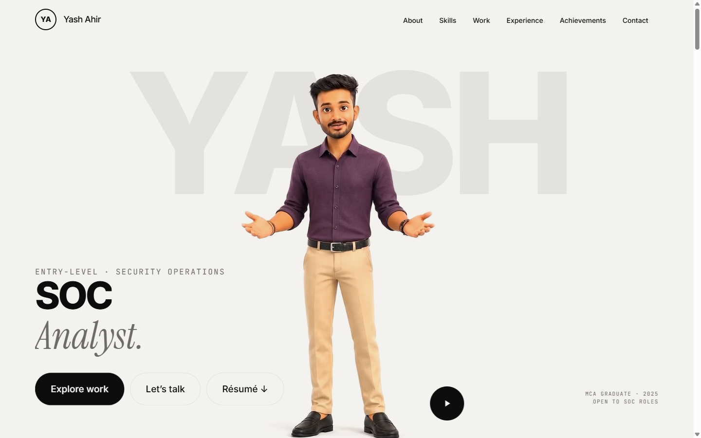
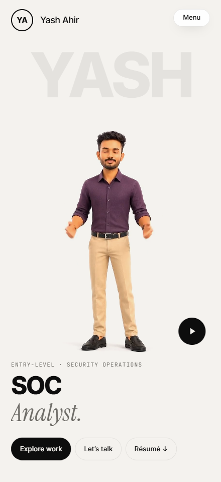
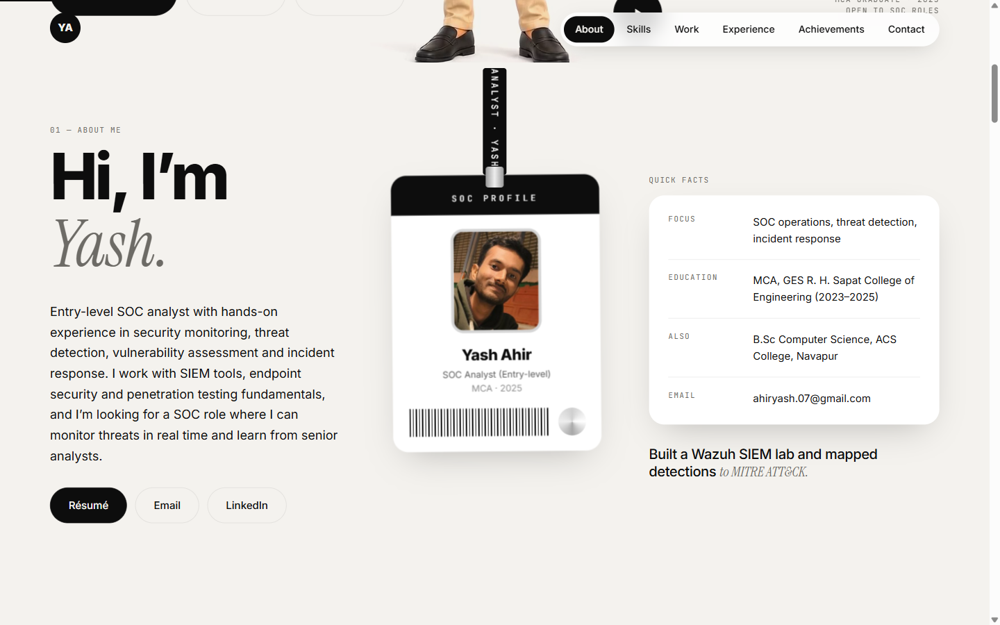
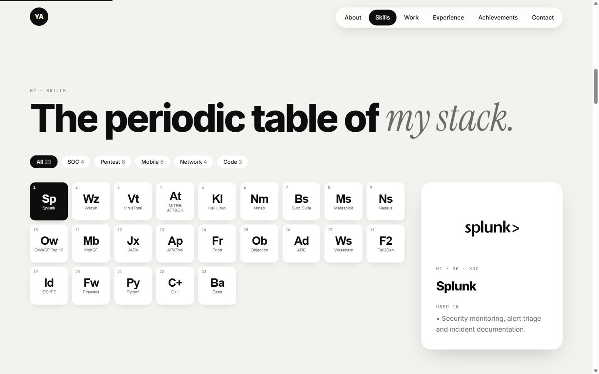
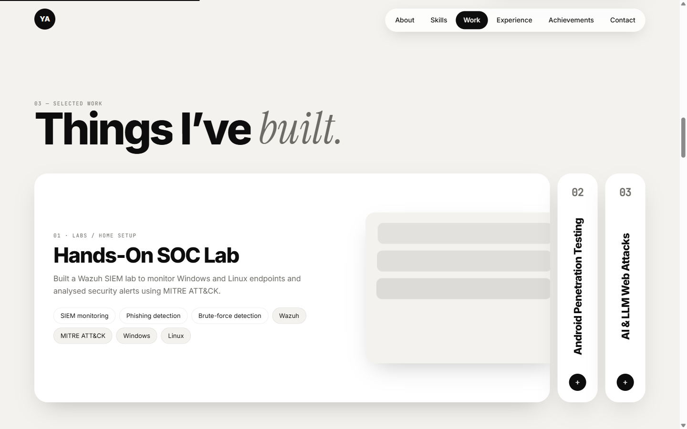
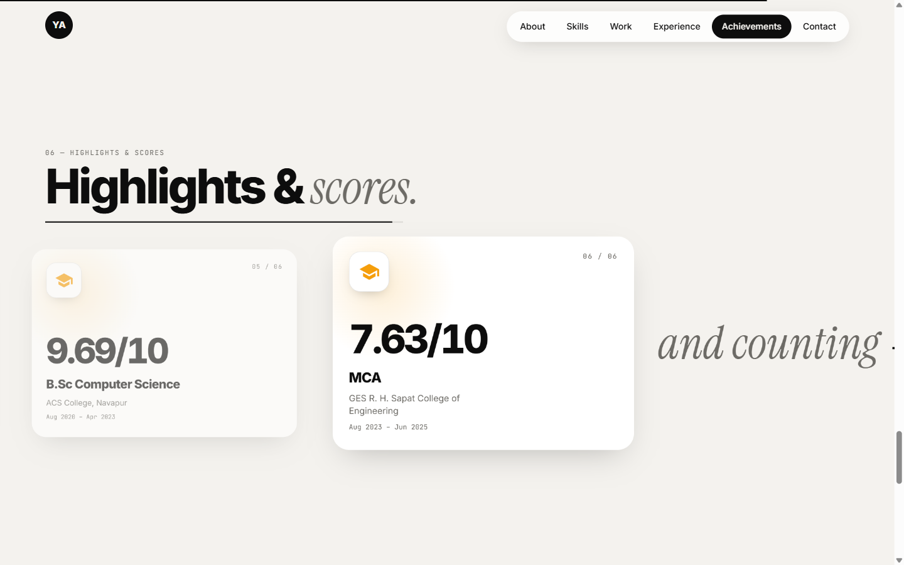
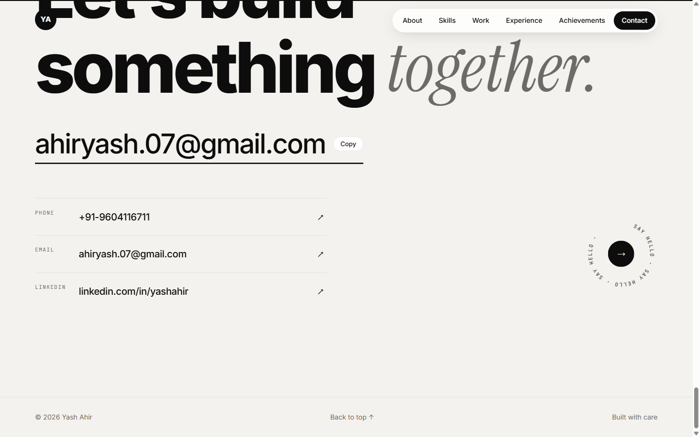

# Yash Ahir — SOC Analyst Portfolio

A responsive, editorial-style developer & security analyst portfolio built with **React 18**, **TypeScript**, and **Vite**. Designed around smooth scroll choreography, interactive data views, and a responsive layout across desktop and mobile viewports.

---

## Preview

### Desktop & Mobile Hero

<table>
  <tr>
    <td width="72%" valign="top">
      
    </td>
    <td width="28%" valign="top">
      
    </td>
  </tr>
  <tr>
    <td align="center"><sub>Desktop (1440×900)</sub></td>
    <td align="center"><sub>Mobile (440×956)</sub></td>
  </tr>
</table>

### Sections Showcase

<details open>
<summary><strong>About &amp; Interactive 3D SOC ID Badge</strong></summary>
<br />

</details>

<details open>
<summary><strong>Skills — Filterable Periodic Table</strong></summary>
<br />

</details>

<details open>
<summary><strong>Selected Work — Expandable Project Accordion</strong></summary>
<br />

</details>

<details open>
<summary><strong>Highlights &amp; Scores — Horizontal Scroll Track</strong></summary>
<br />

</details>

<details open>
<summary><strong>Contact &amp; Footer</strong></summary>
<br />

</details>

---

## Highlights & Features

- **Interactive Video Avatar Hero (`Hero.tsx`)** — Looping muted avatar video (`hero.mp4`) with voice toggle, responsive watermark typography, and stacked mobile layout.
- **Responsive Navigation (`Navbar.tsx`)** — Scroll-progress top bar, active section scroll-spy pill on desktop, and compact dropdown `Menu` pill on mobile (`<= 760px`).
- **Hanging 3D Flip ID Badge (`About.tsx`, `IdBadge.tsx`)** — Swinging lanyard badge with scrolling strap text that flips on hover (or tap on touch devices).
- **Periodic Table of Skills (`Skills.tsx`)** — 23 tools and technologies filterable across `SOC`, `Pentest`, `Mobile`, `Network`, and `Code` with a sticky detail inspector.
- **Expandable Project Accordion (`Work.tsx`)** — Interactive horizontal accordion on desktop that switches to a vertical accordion on mobile.
- **Trainings & Timeline (`Certifications.tsx`, `Experience.tsx`)** — Coursework list with fill-on-hover rows and a scroll-driven vertical timeline.
- **Pinned Horizontal Highlights (`Highlights.tsx`)** — Sticky vertical-to-horizontal scroll track with animated count-up metrics (`9.69/10`, `7.63/10`).
- **One-Click Email Copy & Theme Support (`Contact.tsx`, `index.css`)** — Clipboard copy action, rotating CTA badge, and automatic light/dark `prefers-color-scheme` tokens.

---

## Tech Stack

| Category | Technology |
| --- | --- |
| Framework | React 18 (`react`, `react-dom`) |
| Language | TypeScript 5 |
| Build Tool | Vite 5 (`@vitejs/plugin-react`) |
| Styling | Modular CSS (`src/styles/*.css`) + CSS custom properties |
| Typography | Inter, Instrument Serif, JetBrains Mono |

---

## Getting Started

### Prerequisites

- **Node.js** 18+ and **npm**

### Installation & Local Development

```bash
# Clone the repository
git clone https://github.com/Bhagwatilal/yash_portfolio.git
cd yash_portfolio

# Install dependencies
npm install

# Start the development server
npm run dev
```

### Available Scripts

| Command | Description |
| --- | --- |
| `npm run dev` | Starts the Vite development server |
| `npm run build` | Runs `tsc --noEmit` type-checking and builds production bundle into `dist/` |
| `npm run preview` | Locally previews the production build |

---

## Project Structure

```text
├── public/
│   └── Yash_Ahir_Resume.pdf       # Downloadable résumé
├── docs/
│   └── screenshots/               # Desktop & mobile screenshots for README
├── src/
│   ├── assets/
│   │   ├── hero.mp4               # Hero avatar video
│   │   └── yash.jpg               # ID badge portrait photo
│   ├── components/                # Section components (Hero, About, Skills, Work, ...)
│   ├── data/
│   │   ├── portfolio.ts           # Skills, projects, trainings, timeline & highlights data
│   │   ├── highlightIcons.ts      # SVG icon paths & accent colors for Highlights
│   │   └── skillIcons.ts          # SVG icons for Skills detail card
│   ├── hooks/
│   │   └── useReveal.ts           # IntersectionObserver scroll-reveal hook
│   ├── pages/
│   │   └── Index.tsx              # Main page section composition
│   ├── styles/                    # Per-section stylesheets
│   ├── App.tsx
│   ├── index.css                  # Theme tokens, typography, navbar & reveal rules
│   └── main.tsx
├── index.html
├── package.json
├── tsconfig.json
└── vite.config.ts
```

---

## Customization

- **Content & Metrics:** Edit [src/data/portfolio.ts](src/data/portfolio.ts) to update skills (`SK`), projects (`WK`), trainings (`CE`), experience timeline (`TL`), and highlight cards (`HN`).
- **Avatar & Photo:** Replace `src/assets/hero.mp4` and `src/assets/yash.jpg`.
- **Résumé:** Replace `public/Yash_Ahir_Resume.pdf`.
- **Theme Colors:** Adjust CSS custom properties (`--bg`, `--ink`, `--mut`, `--card`, `--line`) in [src/index.css](src/index.css).
